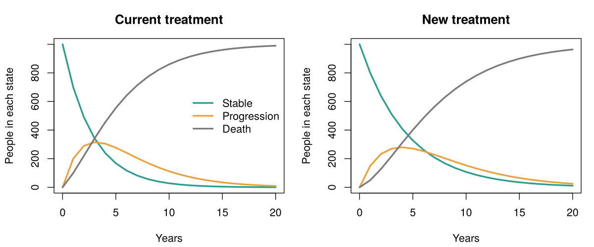

# Modelo de Markov de costo-efectividad en R

*[English version](README.md)*

Mi primer modelo de evaluación económica en salud: compara un tratamiento nuevo, más caro, contra el tratamiento actual, y calcula el costo por QALY ganado (ICER).

> **Aviso:** todos los números de este modelo son **inventados** y sirven solo para aprender la mecánica. No representan ningún medicamento real ni deben usarse para decidir nada.

## Qué hace el modelo

- **Tres estados de salud:** Estable, Progresión y Muerte (estado absorbente).
- **Ciclos anuales** durante 20 años, con una cohorte de 1.000 personas que parte en Estable.
- **Corrección de medio ciclo** y **descuento** de costos y QALY (3% en el caso base).
- **Salidas:** costo y QALY por persona para cada tratamiento, diferencias, ICER, comparación con un umbral de disposición a pagar (USD 20.000 por QALY, valor de ejemplo) y precio máximo del fármaco para quedar bajo ese umbral.

Todos los costos están en dólares estadounidenses (USD).

## Caso base

| | Costo por persona | QALY |
|---|---|---|
| Tratamiento actual | USD 8.648 | 3,149 |
| Tratamiento nuevo | USD 30.706 | 4,263 |
| Diferencia | USD 22.058 | 1,114 |

**ICER: USD 19.805 por QALY ganado**, justo bajo el umbral de ejemplo.

## Análisis de sensibilidad

Cambié un supuesto a la vez y comparé con el caso base.

| Cambio | ICER (USD por QALY) | ¿Bajo USD 20.000? |
|---|---|---|
| Caso base (descuento 3%, precio del nuevo USD 6.000/año) | 19.805 | Sí, por poco |
| Descuento 0% | 18.095 | Sí |
| Descuento 5% | 20.971 | **No** |
| Precio del nuevo USD 4.000/año | 12.823 | Sí |
| Precio del nuevo USD 2.000/año | 5.841 | Sí |
| Precio del nuevo USD 1.500/año | 4.096 | Sí |
| Nuevo con la misma mortalidad que el actual y precio USD 2.000 | No definido | No aporta QALY extra (dominado) |

## Qué aprendí

- **El descuento** cambia cuánto pesa el futuro. El tratamiento nuevo gasta temprano y gana años de vida tarde, así que un descuento mayor sube el ICER. Aquí, pasar de 3% a 5% basta para cambiar la conclusión.
- **El ICER es una recta del precio, no una proporción.** Cada USD 1.000 menos de precio baja el ICER en unos USD 3.500, pero un precio de cero no da ICER cero (da cerca de -USD 1.100), porque el tratamiento nuevo igual reduce costos de progresión.
- **Precio máximo:** con el caso base, el fármaco puede costar hasta ~USD 6.056 al año para quedar en el umbral (~USD 5.740 con descuento 5% y USD 6.607 con 0%).
- **Sin beneficio no hay ICER:** si el tratamiento nuevo no mejora la supervivencia, no hay QALY extra y el indicador no sirve.

## Cómo correrlo

1. Instalar R.
2. Abrir `markov_model.R` y ejecutarlo completo.
3. El script imprime resultados en consola y guarda el gráfico `markov_trace.png`.

No requiere paquetes externos.

## Próximos pasos

- Reimplementarlo con el paquete `heemod`.
- Análisis de sensibilidad probabilístico.
- Replicar un modelo publicado y comparar resultados.
