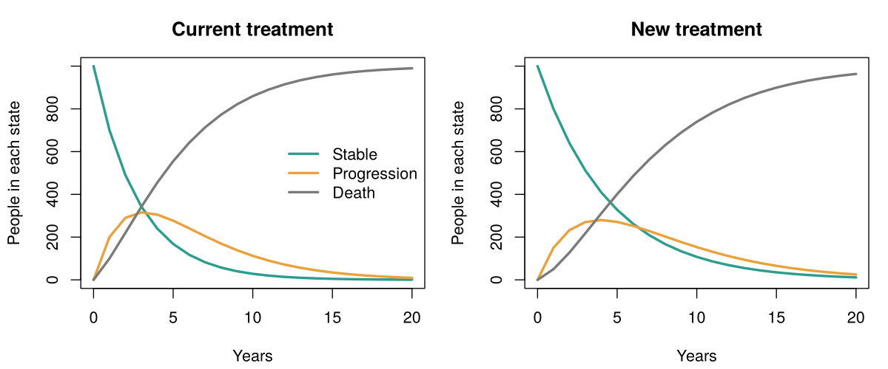

[README.md](https://github.com/user-attachments/files/34327945/README.md)
# Markov cost-effectiveness model in R

My first health economic evaluation model: it compares a new, more expensive treatment against the current one and calculates the cost per QALY gained (ICER).

> **Disclaimer:** every number in this model is **made up** and used only to learn the mechanics. They do not represent any real drug and must not be used for decisions.

## What the model does

- **Three health states:** Stable, Progression and Death (absorbing state).
- **Yearly cycles** over 20 years, with a cohort of 1,000 people starting in Stable.
- **Half-cycle correction** and **discounting** of costs and QALYs (3% in the base case).
- **Outputs:** cost and QALYs per person for each treatment, differences, ICER, comparison against a willingness-to-pay threshold (CLP 20,000,000 per QALY, an example value) and the maximum drug price that keeps the ICER under that threshold.

Costs are in Chilean pesos (CLP). Roughly, US$1 ≈ CLP 930, so the example threshold is about US$21,500 per QALY.

## Base case

| | Cost per person | QALYs |
|---|---|---|
| Current treatment | CLP 8,083,493 | 3.149 |
| New treatment | CLP 28,690,128 | 4.263 |
| Difference | CLP 20,606,635 | 1.114 |

**ICER: CLP 18,501,251 per QALY gained**, below the example threshold.

## Sensitivity analysis

I changed one assumption at a time and compared with the base case.

| Change | ICER | Below CLP 20M? |
|---|---|---|
| Base case (3% discount, new drug price CLP 5.6M/year) | CLP 18.5M | Yes |
| Discount rate 0% | CLP 16.9M | Yes |
| Discount rate 5% | CLP 19.6M | Yes, barely |
| New drug price CLP 3.6M/year | ~CLP 11.5M | Yes |
| New drug price CLP 2.0M/year | ~CLP 5.9M | Yes |
| New drug price CLP 1.5M/year | ~CLP 4.2M | Yes |
| New treatment with the same mortality as the current one, price CLP 2.0M | Undefined | No extra QALYs (dominated) |

## What I learned

- **Discounting** changes how much the future weighs. The new treatment spends early and gains life years late, so a higher discount rate raises the ICER.
- **The ICER is a straight line of the price, not a proportion.** Each CLP 1M less in price lowers the ICER by about CLP 3.5M, but a price of zero does not give an ICER of zero, because the new treatment still reduces progression costs.
- **Maximum price:** in the base case the drug can cost up to about CLP 6.03M per year and still stay at the threshold (about CLP 5.71M with a 5% discount rate).
- **No benefit, no ICER:** if the new treatment does not improve survival there are no extra QALYs and the indicator is meaningless.

## How to run it

1. Install R.
2. Open `markov_model.R` and run the whole script.
3. It prints results to the console and saves the plot as `markov_trace.png`.

No external packages are required.

## Next steps

- Re-implement it with the `heemod` package.
- Probabilistic sensitivity analysis.
- Replicate a published model and compare results.
